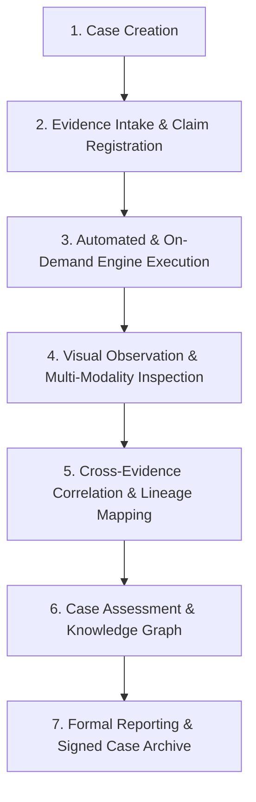
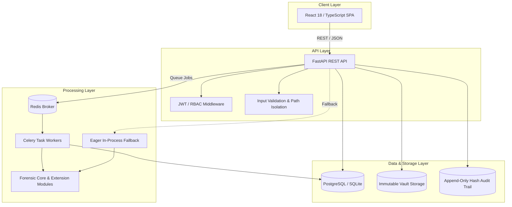

# ForenSight — Digital Image Forensics Platform

An explainable, analyst-first digital image forensics investigation platform engineered for examining image tampering, recompression artifacts, derivative lineage, and metadata consistency.

ForenSight integrates multi-modality forensic signal analysis, cryptographic chain of custody, asynchronous background task processing, and audit-ready reporting into a unified investigative workspace.

---

## 1. Overview

Digital image evidence encountered in real-world investigations frequently passes through messaging platforms, content delivery networks, social media pipelines, screenshotting, resizing, and lossy recompression. In these operating environments, simplistic binary verdicts ("real" vs. "fake") and opaque machine-learning classification scores often fail under rigorous technical scrutiny, producing unexplainable false positives.

ForenSight addresses this challenge through an **explainable, evidence-first framework**:
- **Non-Destructive Ingestion:** Computes cryptographic SHA-256 digests immediately upon acquisition, preserving the original bitstream in immutable storage.
- **Claim-First Context:** Captures investigator context (reported capture date, location, transmission channel, source platform) distinctly from raw forensic measurements.
- **Investigative Signals over Binary Scores:** Analytical engines produce reproducible numerical measurements, frequency distributions, and spatial candidate overlays that serve as forensic indicators requiring contextual analyst interpretation.
- **Provenance & Derivative Lineage:** Discovers exact bitstream duplicates and likely visual derivatives (crops, rescaled images, screenshots) across case inventories.
- **Cryptographic Auditability:** Employs an append-only, sequentially chained audit log alongside digitally signed case export archives.

---

## 2. Key Capabilities

- **Claim-First Intake:** Separates investigative claims and custody acquisition history from engine-derived measurements.
- **Asynchronous Task Architecture:** Offloads computationally intensive computer vision workloads (SIFT keypoints, DCT histograms, Radon transforms) to Celery workers via Redis, with transparent in-process fallback when Redis is unavailable.
- **Multi-Modality Forensic Suite:** Comprehensive suite of 13 analytical engines spanning spatial, compression, device profile, frequency, and geometric domains.
- **Multi-Modality Spatial Heatmaps:** Visualizes spatial anomaly candidates across modalities without synthetic probability masks.
- **Image Version Lineage:** Discovers identical bitstreams and near-duplicate visual derivatives across crops, recompression, and scaling.
- **Processing History Hypotheses:** Synthesizes quantization tables, blocking grids, and interpolation signatures into candidate recompression sequences with explicit uncertainty notes.
- **Cross-Image Hardware Correlation:** Correlates camera hardware signatures (Make, Model, Serial), temporal capture sequences, and shared feature descriptors across multi-image evidence pools.
- **Dual-Canvas Synchronized Inspection:** Side-by-side comparative inspection canvas with locked panning and zoom for pixel-level artifact evaluation.
- **Dual Reporting & Archival Export:**
  - *Forensic Reports:* Compiles formal forensic PDF dossiers (via ReportLab) and raw JSON findings.
  - *Case Bundles (`.forensight`):* Packages raw evidence bitstreams, manifests, and optional Ed25519 digital signatures into a checksummed archive with a standalone verification tool.
- **Content Credentials Inspection:** Inspects C2PA manifest assertions with remote retrieval disabled to prevent network telemetry and preserve analyst privacy.

---

## 3. Forensic Analysis Techniques & Examination Methods

ForenSight provides a modular suite of forensic examination engines. Each engine evaluates specific physical, statistical, or compression characteristics:

| Engine | Primary Method | Forensic Indicator Measured | Technical Limitations |
|---|---|---|---|
| **File Metadata** | EXIF / App1 Structure Parsing | Software signatures, capture timestamps, device tags, GPS, thumbnail consistency. | Metadata is easily stripped or modified; absence does not establish tampering. |
| **Error Level Analysis (ELA)** | Calibrated JPEG Recompression | Absolute pixel difference across compression cycles at calibrated quality levels. | Highlights recompression variance; does not determine intent or prove manipulation. |
| **Noise Residuals** | High-Pass & Median Wavelet Filtering | Localized high-frequency variance distributions and noise inconsistencies. | Legitimate compression or uniform scene textures can cause natural noise variance. |
| **JPEG DCT / Quantization** | 8×8 Block Grid & Quantization Matching | Quantization matrix signatures, coefficient histograms, grid alignment. | Multi-generation saves in authentic software alter frequency distributions. |
| **Copy-Move Detection** | SIFT Keypoint & Block Matching with RANSAC | Cloned spatial regions and affine transformation correspondences. | Natural repeating textures (e.g., foliage, brickwork, fabric) can trigger false correspondences. |
| **Blocking Discontinuity** | Boundary Grid Discontinuity Analysis | Grid boundary mismatches caused by non-aligned image splicing. | Non-aligned cropping can induce global grid shifts across authentic imagery. |
| **Camera Identification** | Device Profile & CFA Consistency | Color Filter Array patterns and sensor hardware profile heuristics. | Heavily compressed or downscaled web images lose sensor noise characteristics. |
| **Frequency Analysis (FFT)** | 2D Discrete Fourier Transform | Periodic interpolation spikes and synthetic frequency domain anomalies. | Global resampling alters spectrum uniformly; localized splices require spatial isolation. |
| **Color Channel Discrepancy** | Inter-Channel Cross-Correlation | Chromatic aberration consistency and spectral channel misalignment. | High-quality apochromatic lenses exhibit minimal natural chromatic dispersion. |
| **Compression History** | NADJPEG & Quantization Ghosting | Non-aligned double JPEG compression artifacts and secondary quantization ghost minima. | Requires recompression at different quality factors or non-congruent grid alignments. |
| **Resampling Analysis** | Radon Transform & Derivative Variance | Periodic interpolation artifacts from affine transformations, scaling, or rotation. | High-order Lanczos or bicubic filters with mild scaling factors can weaken periodicity. |
| **PRNU Sensor Noise** | Wavelet Noise Residual Correlation | Photo-Response Non-Uniformity camera sensor fingerprints. | Requires multiple reference images from the same camera sensor under uniform lighting. |
| **Lighting & Perspective** | 2D Shadow & Solar Vector Heuristics | Directional consistency of cast shadows and estimated illuminant vectors. | Complex multi-source lighting, diffuse reflections, and uneven terrain introduce variance. |

---

## 4. Investigation Workflow

ForenSight enforces an explainable, sequential investigative workflow:



1. **Case Creation:** Establishes investigation scope, case reference identifier, and investigator ownership.
2. **Evidence Intake:** Ingests primary files, generates immutable SHA-256 digests, stores original bitstreams under secure UUID paths, and records transmission provenance.
3. **Engine Execution:** Dispatches selected forensic passes asynchronously through Celery/Redis workers.
4. **Visual Inspection:** Analyst examines modality layers (ELA maps, noise distributions, DCT grids, SIFT match vectors) via dual-canvas comparison.
5. **Correlation & Lineage:** Assesses shared camera hardware, capture chronologies, and near-duplicate visual derivatives across cases.
6. **Assessment & Findings:** Synthesizes observations into structured findings linked to an acyclic investigation knowledge graph.
7. **Reporting & Archival:** Compiles formal forensic PDF dossiers and exports cryptographically signed `.forensight` case bundles.

---

## 5. Application Architecture



---

## 6. Technology Stack

| Layer | Technology | Primary Purpose |
|---|---|---|
| **Frontend** | React 18, TypeScript, Vite | Single-page application, responsive layout, dual-canvas inspection. |
| **UI Styling** | Custom CSS Variables, Lucide Icons | Design-token-driven Light and Dark themes, accessible contrast. |
| **Backend API** | FastAPI, Python 3.12, Pydantic V2 | Async API endpoints, schema validation, route-level authorization. |
| **Task Queue** | Celery, Redis | Asynchronous background processing with deterministic job state tracking. |
| **Database** | PostgreSQL 15 / SQLite, SQLAlchemy 2 | Relational metadata persistence, Alembic database migrations. |
| **Forensic Engines** | NumPy, OpenCV, Pillow, SciPy | Computer vision routines, numerical matrix operations, transforms. |
| **Reporting** | ReportLab | Programmatic generation of formal forensic PDF dossiers. |
| **Security** | PyJWT, Passlib (bcrypt 3.2.0), Cryptography (Ed25519) | Authentication, password hashing, asymmetric archive signing. |
| **Containerization**| Docker, Docker Compose | Production-ready multi-container orchestration. |

---

## 7. Repository Structure

```text
ForenSight/
├── .github/
│   └── workflows/ci.yml             # CI/CD pipeline (backend, frontend, Docker, integration)
├── backend/
│   ├── app/
│   │   ├── api/                     # REST API routers (cases, evidence, jobs, reports, auth)
│   │   ├── core/                    # Security, configuration, Celery worker definitions
│   │   ├── db/                      # SQLAlchemy database session and base models
│   │   ├── engine_extensions/       # Advanced forensic engines (PRNU, resampling, geometry, etc.)
│   │   ├── forensics/               # Core forensic modules (metadata, ela, noise, jpeg_dct, copy_move)
│   │   ├── models/                  # Database entity models
│   │   ├── schemas/                 # Pydantic domain schemas and request/response contracts
│   │   ├── services/                # Business logic services (case, evidence, report, lineage)
│   │   └── tasks/                   # Celery background task handlers
│   ├── benchmarks/                  # Academic evaluation benchmark protocols and results
│   ├── datasets/
│   │   ├── benchmark/               # Benchmark reports and execution results
│   │   ├── controlled/v1/           # Frozen controlled manipulation fixtures (fixtures 001–009)
│   │   └── external/                # External benchmark dataset adapters and templates
│   ├── scripts/                     # Operational scripts (seed_demo, verify_freeze, case_bundle)
│   └── tests/                       # Complete pytest suite (unit, integration, security)
├── datasets/                        # External dataset manifests (CASIA, Columbia, NIST templates)
├── docs/                            # Architectural specifications, security, workflows
├── frontend/
│   ├── public/                      # Static assets and favicon
│   ├── screenshots/                 # UI verification screenshots (desktop, tablet, mobile)
│   ├── src/
│   │   ├── components/              # Shared UI components, layout, visual viewers, modals
│   │   ├── contexts/                # Authentication and Theme contexts
│   │   ├── pages/                   # Application route pages (Workspace, Reports, Cases, Intake)
│   │   └── api.ts                   # Unified API client and fetch wrapper
│   └── test.cjs                     # Critical browser workflow integration test
├── docker-compose.yml               # Container orchestration configuration
├── .env.example                     # Environment configuration template
└── .gitignore                       # Git exclusion rules
```

---

## 8. Prerequisites

- **Python:** Version 3.11 or 3.12 (64-bit)
- **Node.js:** Version 20 LTS or higher, with `npm`
- **Docker & Docker Compose:** Optional for containerized deployment (recommended for production)
- **System Libraries (Linux):** `libgl1`, `libglib2.0-0` (required for headless OpenCV and Pillow)

---

## 9. Installation & Setup

### Option A: Containerized Deployment (Recommended)

1. Clone the repository:
   ```bash
   git clone https://github.com/kharbashpriyanshu/ForenSight.git
   cd ForenSight
   ```
2. Configure environment variables:
   ```bash
   cp .env.example .env
   ```
   *Edit `.env` to define secure credentials for `SECRET_KEY`, `POSTGRES_PASSWORD`, and `REDIS_PASSWORD`.*
3. Launch container stack:
   ```bash
   docker compose up -d --build
   ```
4. Access the web interface at `http://localhost:5173` (or API at `http://localhost:8000`).

---

### Option B: Native Local Development

#### 1. Backend Setup

```bash
cd backend

# Create and activate virtual environment
python -m venv venv

# Windows:
.\venv\Scripts\activate
# Linux/macOS:
# source venv/bin/activate

# Upgrade pip and install dependencies
python -m pip install --upgrade pip
pip install -r requirements.txt

# Seed demonstration accounts and cases
python scripts/seed_demo.py
```

#### 2. Frontend Setup

```bash
cd ../frontend

# Install dependencies
npm install

# Verify production build
npm run build
```

---

## 10. Environment Configuration

All configuration is managed through environment variables or a root `.env` file. Key variables:

| Variable | Default Value | Description |
|---|---|---|
| `ENVIRONMENT` | `development` | Set to `production` in live environments. |
| `SECRET_KEY` | *Generated secret* | Cryptographic key for signing JWT session tokens (minimum 32 characters). |
| `DATABASE_URL` | `sqlite:///./forensight.db` | Database connection string (PostgreSQL in production). |
| `REDIS_URL` | `redis://127.0.0.1:6379/0` | Redis instance for Celery task broker and results. |
| `CELERY_TASK_ALWAYS_EAGER`| `true` (dev default) | When `true`, runs tasks synchronously in-process without requiring Redis. |
| `BACKEND_CORS_ORIGINS` | `http://localhost:5173` | Comma-separated list of permitted CORS origins. |
| `CASE_EXPORT_SIGNING_PRIVATE_KEY` | *(Empty)* | Base64-encoded 32-byte Ed25519 private key for signing `.forensight` case bundles. |

> **Production Security Note:** In production, `ENVIRONMENT` must be set to `production`, `CELERY_TASK_ALWAYS_EAGER` must be `false`, and unique credentials must be provided for all database and broker connections.

---

## 11. Database Initialization & Demonstration Accounts

ForenSight uses SQLAlchemy with Alembic migrations.

For local development, running `seed_demo.py` creates and seeds the database idempotently:

```bash
cd backend
python scripts/seed_demo.py
```

Pre-configured development demonstration accounts:

| Username | Password | Role | Assigned Case |
|---|---|---|---|
| `admin` | `forensight_admin` | `ADMIN` | Recruiter Demonstration Case |
| `user_a` | `forensight_user_a` | `INVESTIGATOR` | Case Alpha (User A) |
| `user_b` | `forensight_user_b` | `INVESTIGATOR` | Case Beta (User B) |

---

## 12. Running the Application Locally

1. **Start Backend API:**
   ```bash
   cd backend
   .\venv\Scripts\activate
   python -m uvicorn app.main:app --host 127.0.0.1 --port 8000 --reload
   ```
2. **Start Celery Worker (Optional; if Redis is running):**
   ```bash
   cd backend
   .\venv\Scripts\activate
   celery -A app.tasks.celery_tasks worker --loglevel=info
   ```
   *(If Redis is not running, set `CELERY_TASK_ALWAYS_EAGER=true` in `.env` for in-process synchronous task execution).*

3. **Start Frontend Development Server:**
   ```bash
   cd frontend
   npm run dev
   ```
   Open `http://localhost:5173` in your browser.

---

## 13. Testing & Verification

ForenSight maintains comprehensive test suites across backend engines, frontend interfaces, and cryptographic pipelines:

### Backend Testing
```bash
cd backend
.\venv\Scripts\activate

# Run complete pytest test suite
pytest tests/ -v

# Verify scientific core freeze invariant (all 38 forensic core files)
python scripts/verify_scientific_freeze.py

# Verify cryptographic audit chain integrity across all cases
python scripts/audit_integrity.py verify-chain

# Run dedicated authentication and RBAC security regression tests
pytest tests/test_security_auth.py -v
```

### Frontend Testing
```bash
cd frontend

# Validate TypeScript type definitions
npx tsc --noEmit

# Verify production bundle compilation
npm run build

# Execute critical browser workflow test (headless Puppeteer)
npm run test:e2e
```

---

## 14. Scientific Evaluation & Benchmark Methodology

To prevent undetected regressions in forensic algorithms, ForenSight employs a dual evaluation strategy:

1. **Scientific Core Freeze (`forensics_freeze_manifest.json`):**
   All 38 core forensic implementation files are cryptographically fingerprinted (SHA-256). The verification script `verify_scientific_freeze.py` runs in CI to guarantee that forensic algorithms remain unchanged unless an explicit freeze update is authorized.

2. **Controlled Test Fixtures (`backend/datasets/controlled/v1/`):**
   Includes 9 controlled test fixtures designed to evaluate individual detector responses against known ground truths:
   - `fixture_001_authentic`: Camera original reference.
   - `fixture_002_jpeg_q50` / `q75` / `q95`: Single JPEG compression baselines.
   - `fixture_003_jpeg_double_q95_q75`: Double JPEG compression.
   - `fixture_004_geometry_resample`: Geometric scaling and interpolation.
   - `fixture_005_copymove_clone`: Cloned object insertion.
   - `fixture_006_splicing_donor`: Spliced composite donor imagery.
   - `fixture_007_noise_injection`: Localized noise variance injection.
   - `fixture_008_color_shift`: Localized color channel manipulation.
   - `fixture_009_false_positive_texture`: Legitimate repeating natural texture (negative control).

3. **External Dataset Protocols (`docs/EXTERNAL_BENCHMARK_PROTOCOL.md`):**
   Provides ingestion templates and manifest adapters for external benchmark corpora (e.g., CASIA, Columbia, NIST OpenMFC). *Note: External third-party datasets must be independently licensed and obtained.*

---

## 15. Security & Evidence Integrity Considerations

- **Cryptographic Ingestion:** Evidence bitstreams are hashed (SHA-256) upon arrival and stored under isolated UUID-based paths. Absolute filesystem paths are suppressed from API responses to protect server topology.
- **Append-Only Audit Ledger:** Key investigative actions (intake, job execution, report compilation, bundle export) append to a sequentially chained event ledger verified via `python backend/scripts/audit_integrity.py verify-chain`.
- **Signed Case Bundles (`.forensight`):**
  Exported archives contain raw evidence, manifests, and an optional Ed25519 digital signature. Key generation and standalone verification:
  ```bash
  # Generate server signing keypair
  python backend/scripts/generate_case_export_key.py

  # Standalone bundle verification
  python backend/scripts/verify_case_bundle.py case_export.forensight --trusted-fingerprint <sha256_fingerprint>
  ```
- **Path Traversal Defenses:** Upload handling uses strict MIME inspection, file extension whitelists, and canonicalized `pathlib.Path.resolve` path containment checks.
- **HTTP Security Headers:** Endpoints emit `X-Content-Type-Options: nosniff`, `X-Frame-Options: DENY`, `X-XSS-Protection: 1; mode=block`, and `Referrer-Policy: strict-origin-when-cross-origin`.

---

## 16. Responsible Forensic Interpretation

ForenSight explicitly rejects automated "real vs. fake" scoring. Forensic signals must be interpreted responsibly:

1. **SHA-256 Proves File Integrity, Not Scene Authenticity:** A cryptographic hash confirms that an evidence file has not changed since ingestion; it does not prove the captured scene is untampered.
2. **Absence of Metadata Does Not Mean Manipulation:** Social networks and messaging applications routinely strip EXIF metadata to protect user privacy.
3. **Compression Artifacts Reflect History, Not Guilt:** Error Level Analysis and DCT block variations establish recompression differences, which often occur through benign re-saving or resizing.
4. **Repeating Textures Trigger Candidate Matches:** Copy-move feature matching identifies repeating visual patterns; natural repeating structures (brick walls, window grids, foliage) require analyst triage.
5. **Assessment Levels Are Qualitative Indicators:** System-generated assessments categorize observational consistency; they are not statistical probabilities of tampering.

---

## 17. Interface Preview

ForenSight includes a dedicated web interface optimized for forensic analysts across Light and Dark themes:

| Screen | Description | Reference Asset |
|---|---|---|
| **Investigation Directory** | Multi-case management, status tracking, search and filter controls. | [`frontend/screenshots/04_cases_light_desktop.png`](frontend/screenshots/04_cases_light_desktop.png) |
| **Evidence Detail & Inspection** | Visual inspection viewport, modality layer overlays, parameter tuning. | [`frontend/screenshots/13_evidence_detail_light_desktop.png`](frontend/screenshots/13_evidence_detail_light_desktop.png) |
| **Analyst Workspace** | Side-by-side synchronized comparison, findings management, notes. | [`docs/screenshots/analyst_workspace_findings.png`](docs/screenshots/analyst_workspace_findings.png) |
| **Reports & Archival Export** | Dossier compilation (PDF/JSON) and cryptographically signed case export. | Available in `visual-qa-screenshots/final-report-audit/` |

---

## 18. Acknowledgements & References

ForenSight builds upon foundational scientific research in digital image forensics and signal processing:
- **Error Level Analysis (ELA):** Krawetz, N. (2007). *A Picture's Worth... Digital Image Analysis*.
- **Copy-Move Forgery Detection:** Fridrich, A. J., Soukal, B. D., & Lukáš, A. J. (2003). *Detection of copy-move forgery in digital images*.
- **Resampling & Interpolation Detection:** Popescu, A. C., & Farid, H. (2005). *Exposing digital forgeries by detecting traces of resampling*.
- **JPEG Quantization & Ghosting:** Farid, H. (2009). *Exposing digital forgeries from JPEG ghosts*.
- **PRNU Sensor Fingerprinting:** Chen, M., Fridrich, J., Goljan, M., & Lukáš, J. (2008). *Determining image origin and integrity using sensor noise*.
