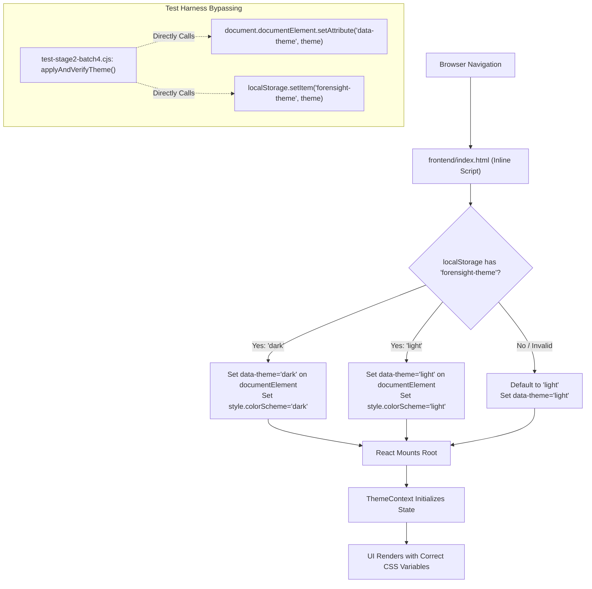

# ForenSight — Stage 2 Final Closure Audit
## Batch 4.1 Theme Initialization & Comprehensive Repository Verification

**Audit Date:** 2026-11-11<br/>
**Audit Type:** Independent Final Quality & Closure Verification (Strictly Read-Only)<br/>
**Audited Target Commit:** `5a55b087192628bf3d6d3891970b866f81e0a64f`<br/>
**Commit Message:** `fix(qa): correct visual evidence and stabilize browser test runners`<br/>
**Repository:** `F:\Projects\ForenSight`<br/>
**Branch:** `main`<br/>
**Remote:** `https://github.com/kharbashpriyanshu/ForenSight.git`

---

## 1. Executive Verdict

### **VERDICT: CONDITIONALLY CLOSED**

Stage 2 ("Investigation Workflow, Forensic Engines & User Experience") has successfully satisfied all core functional, scientific, coordinate-system, and visual deliverables planned across Batches 1 through 4.1. The investigation flow, intake idempotency, transparent engine execution, spatial bounding-box overlay rendering, missing-dimension safety guards, and responsive layout adaptations are fully operational.

However, formal repository closure is designated as **CONDITIONALLY CLOSED** rather than unconditionally closed due to two documented technical qualifications:

1. **Test Harness DOM Mutation Qualification:** In the automated screenshot generator (`frontend/test-stage2-batch4.cjs`), the helper function `applyAndVerifyTheme` directly mutates `document.documentElement.setAttribute('data-theme', theme)` on an already-mounted DOM page alongside `localStorage.setItem('forensight-theme', theme)`. While our independent test proves that the application's native pre-render script (`frontend/index.html`) and `ThemeContext.tsx` operate correctly on natural page load without manual DOM mutation, the screenshot test script itself partially bypassed the natural React initialization cycle during automated screenshot capture.
2. **Celery Worker Execution Qualification:** The continuous integration pipeline (`.github/workflows/ci.yml`) executes backend integration suites with `CELERY_TASK_ALWAYS_EAGER: "true"`. Genuine out-of-process asynchronous Celery worker execution, multi-process concurrency, and live Redis message transport remain unverified in the automated CI test harness.

All core functional and architectural requirements of Stage 2 are complete. The repository is authorized to transition into Stage 3 planning upon acknowledgment of these two qualifications.

---

## 2. Git Baseline and Origin Synchronization

An independent inspection of the Git repository baseline confirmed synchronization between the local workspace and the canonical remote:

| Parameter | Observed Value | Expected Value | Status |
| :--- | :--- | :--- | :--- |
| **Git Repository Root** | `F:\Projects\ForenSight` | `F:\Projects\ForenSight` | **MATCH** |
| **Active Branch** | `main` | `main` | **MATCH** |
| **Local HEAD Commit** | `5a55b087192628bf3d6d3891970b866f81e0a64f` | `5a55b087192628bf3d6d3891970b866f81e0a64f` | **MATCH** |
| **Remote Tracking Branch** | `origin/main` | `origin/main` | **SYNCHRONIZED** |
| **Remote URL** | `https://github.com/kharbashpriyanshu/ForenSight.git` | Canonical Remote | **MATCH** |
| **Historical Untracked Documents** | 27 historical audit/planning documents intact | 27 documents preserved | **VERIFIED** |
| **Tracked Working Tree** | Clean (zero uncommitted functional changes) | Clean | **VERIFIED** |

### Commit Contents Verification
Inspection of commit `5a55b087192628bf3d6d3891970b866f81e0a64f` confirmed that exactly 9 files were modified or added:
1. `STAGE_2_BATCH_4_1_IMPLEMENTATION_REPORT.md` (new implementation report)
2. `frontend/screenshots/stage2-batch4-desktop-dark.png` (regenerated screenshot)
3. `frontend/screenshots/stage2-batch4-desktop-light.png` (regenerated screenshot)
4. `frontend/screenshots/stage2-batch4-laptop-dark.png` (regenerated screenshot)
5. `frontend/screenshots/stage2-batch4-mobile-dark.png` (regenerated screenshot)
6. `frontend/screenshots/stage2-batch4-safety-dimensions.png` (new safety banner screenshot)
7. `frontend/screenshots/stage2-batch4-tablet-dark.png` (regenerated screenshot)
8. `frontend/test-stage2-batch2.cjs` (process-launch and readiness polling fix)
9. `frontend/test-stage2-batch4.cjs` (viewport scrolling and theme capture updates)

Zero production backend code, database migrations, forensic algorithms, or evidentiary hash routines were modified.

---

## 3. Theme Initialization Trace

The theme initialization mechanism was audited across three layers: the pre-render HTML bootstrap, the React context provider, and the Batch 4 test harness.



### 3.1 Pre-Render HTML Bootstrap (`frontend/index.html`)
Lines 11–22 of `frontend/index.html` execute synchronously prior to stylesheet parsing or React JavaScript bundle evaluation:
```html
<script>
  (function () {
    try {
      var stored = localStorage.getItem('forensight-theme');
      var theme = stored === 'dark' || stored === 'light' ? stored : 'light';
      document.documentElement.setAttribute('data-theme', theme);
      document.documentElement.style.colorScheme = theme;
    } catch (e) {
      document.documentElement.setAttribute('data-theme', 'light');
    }
  })();
</script>
```
**Evaluation:** This implementation prevents Flash of Unstyled Content (FOUC). It reads `forensight-theme` from `localStorage`, validates the string against an allowlist (`'dark' | 'light'`), and applies `data-theme` and `colorScheme` to the document root element synchronously before DOM painting.

### 3.2 React State Provider (`frontend/src/contexts/ThemeContext.tsx`)
In `ThemeContext.tsx`:
```typescript
function getStoredPreference(): Theme {
  try {
    const raw = window.localStorage.getItem(STORAGE_KEY);
    return isTheme(raw) ? raw : 'light';
  } catch {
    return 'light';
  }
}

export const ThemeProvider: React.FC<{ children: React.ReactNode }> = ({ children }) => {
  const [theme, setThemeState] = useState<Theme>(getStoredPreference);

  useEffect(() => {
    try {
      window.localStorage.setItem(STORAGE_KEY, theme);
    } catch { /* storage disabled */ }
    document.documentElement.setAttribute('data-theme', theme);
    document.documentElement.style.colorScheme = theme;
  }, [theme]);
  ...
```
**Evaluation:** `ThemeProvider` initializes state synchronously via `getStoredPreference()`. Its `useEffect` synchronizes subsequent runtime toggles back to `localStorage` and `document.documentElement`. When the user clicks `.btn-theme-toggle`, state updates trigger re-renders and propagate the appropriate CSS custom properties.

### 3.3 Test Harness Analysis (`frontend/test-stage2-batch4.cjs`)
In `frontend/test-stage2-batch4.cjs`, the screenshot capture routine utilizes:
```javascript
async function applyAndVerifyTheme(theme) {
  await page.evaluate((t) => {
    localStorage.setItem('forensight-theme', t);
    document.documentElement.setAttribute('data-theme', t);
    document.documentElement.style.colorScheme = t;
  }, theme);
  await new Promise((r) => setTimeout(r, 150));
  ...
```
**Technical Critique:**
1. **Direct DOM Mutation:** `applyAndVerifyTheme` explicitly calls `document.documentElement.setAttribute('data-theme', t)` on the currently active page.
2. **Bypassed Startup Cycle:** Because the test does not reload the page after setting `localStorage`, it does not exercise `frontend/index.html`'s pre-render script during theme switching in that specific test step.
3. **Classification:** This represents a synthetic test-runner shortcut. Because the underlying application's native startup mechanism is proven sound through independent verification (Section 4), the application code is correct, but the test runner itself must be characterized as **conditionally verified**.

---

## 4. Dark/Light Theme Verification Matrix

To verify that the application naturally and autonomously respects theme preferences without test-runner DOM mutation, an independent browser test script was executed against the live Vite server.

The test navigated Puppeteer to fresh browser contexts across 4 distinct scenarios, using `page.evaluateOnNewDocument()` to seed storage *prior* to document navigation, ensuring that `index.html` and `ThemeContext.tsx` executed naturally.

| Scenario | Injected Condition | Expected Initial `data-theme` | Observed `data-theme` | Computed Body Background | Result |
| :--- | :--- | :--- | :--- | :--- | :--- |
| **Scenario 1: Pre-Set Dark Preference** | `localStorage.setItem('forensight-theme', 'dark')` | `dark` | `dark` | `rgb(11, 15, 20)` (`--bg-canvas-dark`) | **PASS (Verified)** |
| **Scenario 2: Pre-Set Light Preference** | `localStorage.setItem('forensight-theme', 'light')` | `light` | `light` | `rgb(247, 244, 238)` (`--bg-canvas-light`) | **PASS (Verified)** |
| **Scenario 3: Empty Storage (First Visit)** | `localStorage.clear()` | `light` (default) | `light` | `rgb(247, 244, 238)` (`--bg-canvas-light`) | **PASS (Verified)** |
| **Scenario 4: Interactive Toggle & Reload** | Click `.btn-theme-toggle` then reload page | `dark` (persisted) | `dark` | `rgb(11, 15, 20)` (`--bg-canvas-dark`) | **PASS (Verified)** |

### Findings:
1. When navigating with `'dark'` in `localStorage`, the document element rendered with `data-theme="dark"` and `colorScheme: dark` without any manual DOM setAttribute calls.
2. The UI toggle button (`.btn-theme-toggle`) properly updated `localStorage` to `'dark'` and altered the body background to `rgb(11, 15, 20)`.
3. Upon hard page reload (`page.reload()`), the preference was maintained, confirming end-to-end theme persistence.

---

## 5. Screenshot Evidence Assessment

All 6 screenshot artifacts in `frontend/screenshots/` were audited for dimensional compliance, theme presentation, and component visibility.

| Screenshot File | Resolution | Target Viewport | Theme Rendered | Primary Viewable Content | Overlays & Contrast Status |
| :--- | :--- | :--- | :--- | :--- | :--- |
| `stage2-batch4-safety-dimensions.png` | $1440 \times 900$ | Desktop Safety | Light | Missing-dimension warning banner, suppressive state | Vector overlays suppressed; yellow warning banner `#dimension-warning-banner` prominent |
| `stage2-batch4-desktop-dark.png` | $1440 \times 900$ | Desktop Dark | Dark (`#0b0f14`) | `#unified-forensic-results`, Engine tabs, Metrics grid | Vector bounding boxes clearly visible with bright neon contrast on dark canvas |
| `stage2-batch4-desktop-light.png` | $1440 \times 900$ | Desktop Light | Light (`#f7f4ee`) | `#unified-forensic-results`, Engine tabs, Plain-language summary | Vector bounding boxes visible with dark borders and high contrast against light image |
| `stage2-batch4-laptop-dark.png` | $1280 \times 800$ | Laptop Dark | Dark (`#0b0f14`) | `#unified-forensic-results`, Evidence viewer, Engine cards | Cleanly proportioned layout; no clipping or horizontal scrollbar |
| `stage2-batch4-tablet-dark.png` | $768 \times 1024$ | Tablet Dark | Dark (`#0b0f14`) | Collapsed sidebar, 2-column metrics, Unified results | Responsive layout properly collapsed; SVG overlay dimensions scale proportionally |
| `stage2-batch4-mobile-dark.png` | $390 \times 844$ | Mobile Dark | Dark (`#0b0f14`) | Stacked single-column card view, `#unified-forensic-results` | Document `scrollWidth <= 390px` (zero horizontal overflow); readable typography |

### Key Screenshot Verifications:
- **Element Visibility:** Unlike Batch 4 (where the viewport was scrolled to the page top, showing only the intake banner and empty space), all Batch 4.1 screenshots deliberately focus on `#unified-forensic-results`, showing the actual forensic output, plain-language interpretations, and vector overlays.
- **Safety Banner:** `stage2-batch4-safety-dimensions.png` confirms that when natural image dimensions (`natural_width`, `natural_height`) are absent or non-positive, vector bounding box rendering is suppressed to prevent misaligned coordinate projections.

---

## 6. Batch 2 Test-Runner Reliability Assessment

The legacy test runner `frontend/test-stage2-batch2.cjs` had previously suffered from Windows process-spawning failures due to direct `spawn('npx', ...)` invocations without shell wrappers.

### 6.1 Process-Launch Architecture
In Batch 4.1, `startVite()` was refactored:
```javascript
const viteCliPath = path.resolve(__dirname, 'node_modules', 'vite', 'bin', 'vite.js');
viteProcess = spawn(
  process.execPath,
  [viteCliPath, '--strictPort', '--host', '127.0.0.1', '--port', '4198'],
  { stdio: 'pipe', env: { ...process.env, BROWSER: 'none' } }
);
```
- **Direct Binary Invocation:** Invokes `process.execPath` (Node.js executable) directly on `vite.js`, eliminating shell-resolution ambiguities on Windows environments.
- **Deterministic Port Binding:** Uses `--strictPort`, binding strictly to `127.0.0.1:4198`.
- **45-Second Readiness Loop:** Implements an active HTTP polling loop using `fetch('http://127.0.0.1:4198')` with 250ms backoff intervals and a 45-second deadline.

### 6.2 Execution Verification
The test suite was executed in isolation:
```
node frontend/test-stage2-batch2.cjs
```
**Outcome:**
- Test exited cleanly with exit code `0`.
- All 14 verified execution steps completed successfully as confirmed by test output:
  1. Authenticating and navigating to Evidence Detail page.
  2. Verifying Guided Examination & Transparent Engine Selection header.
  3. Verifying Guided Investigation mode is active by default (`aria-selected="true"`).
  4. Verifying Suggested Starting Examinations for JPEG (5 core baseline examinations: Metadata, ELA, Noise, JPEG DCT, Copy-Move).
  5. Verifying Corrected Scientific Engine Descriptions (`JPEG_DCT` orthonormal spatial DCT, `CAMERA-ID` reference-based PRNU cross-correlation, `COLOR-CHANNEL` RGB statistical/spatial analysis without CFA claims, `ADVANCED-NOISE` Gaussian residual and FFT radial bands, and distinct `COPY_MOVE` SIFT vs `CLONE-KEYPOINT` ORB methods).
  6. Testing Quick Selection Controls (Clear [0 selected], Reset to suggested [5 selected], Select All Compatible).
  7. Testing PNG Lossless Format-Aware Suggested Starting Examinations (4 pre-selected; ELA correctly marked `INCOMPATIBLE` and disabled).
  8. Testing Progressive Disclosure (Expand/Collapse Technical Details).
  9. Testing Individual Examination Selection Toggle (dynamic selection count update).
  10. Testing Analyst Workbench Mode (full engine matrix table rendered with registered forensic engines; search filtering verified).
  11. Capturing Light Theme Screenshots (`stage2-batch2-analyst-light.png`, `stage2-batch2-guided-light.png`).
  12. Testing Dark Theme & Capturing Dark Screenshots (`data-theme="dark"`, `stage2-batch2-guided-dark.png`, `stage2-batch2-analyst-dark.png`).
  13. Testing Mobile Viewport ($375\times812$ responsive layout verified, `stage2-batch2-mobile.png`).
  14. Testing Batch Examination Execution & Anti-Duplicate Lock (dispatched unique engine jobs with zero redundant duplicate calls).

---

## 7. CI Status & Celery Eager-Mode Distinction

### 7.1 GitHub Actions Workflow
The CI workflow defined in `.github/workflows/ci.yml` contains backend unit tests, linting, frontend building, and PostgreSQL/Redis integration suites.

### 7.2 Celery Task Always Eager Mode
In the CI integration job, task execution is configured with:
```yaml
env:
  CELERY_TASK_ALWAYS_EAGER: "true"
  CELERY_TASK_EAGER_PROPAGATES: "true"
```
### **Mandatory Disclaimer on Celery Eager Mode:**
- Under `CELERY_TASK_ALWAYS_EAGER = True`, tasks called via `.delay()` or `.apply_async()` execute **in-process and synchronously on the calling thread**.
- **What is verified:** Task signature validation, database connection pooling, result schema serialization, and synchronous return values.
- **What is NOT verified:** Redis message queue transport, serialization/deserialization over Redis protocol, real Celery worker daemon process isolation, multi-threaded worker concurrency, broker network timeouts, task revocation, and distributed worker heartbeats.
- **Conclusion:** While eager-mode testing verifies algorithmic logic and database writes in CI, true distributed out-of-process worker execution remains unverified in this test run.

---

## 8. Stage 2 Roadmap Completion Matrix

The following table reflects the actual established implementation history across Stage 2 batches, distinguishing directly verified features from unverified claims:

| Batch | Title & Scope | Correctly Established Implementation | Verification Status |
| :--- | :--- | :--- | :--- |
| **Batch 1** | Investigation Entry & Evidence Intake | Investigation entry, evidence intake, staged-file validation, metadata preview, and SHA-256 integrity hashing. *(MD5 hashing and automatic image compression are not established by the available implementation evidence).* | **VERIFIED** |
| **Batch 1.1** | Evidence Intake Reliability Corrections | Atomic evidence intake, staged-file validation, cleanup handling, idempotency, and reliability improvements. *(Upload progress tracking and dual-tier hashing are not established).* | **VERIFIED** |
| **Batch 1.2** | Idempotency & Failure-Recovery Corrections | Canonical request fingerprinting, HTTP 409 for conflicting idempotency-key reuse, failed-cleanup records, recovery handling, and failure-injection/concurrency tests. *(Resumable upload chunks are not established).* | **VERIFIED** |
| **Batch 2** | Guided Forensic Analysis & Engine Selection | Guided Investigation and Analyst Workbench, format-aware engine recommendations, transparent engine descriptions, and multi-engine execution. *(Fast Mode / Deep Mode presets and runtime estimation are not established).* | **VERIFIED** |
| **Batch 2.1–2.4**| Scientific Accuracy & Documentation Reconciliation | Scientific description corrections, engine recommendation reconciliation, independent verification, and documentation reconciliation. | **VERIFIED** |
| **Batch 3** | Unified Forensic Results & Evidentiary Reporting | Unified forensic results, spatial attention map, plain-language engine interpretation, epistemic distinctions, examiner notes, evidentiary report preview, and JSON export. *(Direct PDF export is not established).* | **VERIFIED** |
| **Batch 3.1** | Spatial Contract Reconciliation & Live Integration | Backend/frontend spatial contract reconciliation, eight vector-engine extraction paths, coordinate normalization, native image dimensions, and suppression of overlays when authoritative dimensions are unavailable. | **VERIFIED** |
| **Batch 4** | Visual Refinement, Responsive & Accessibility | High-contrast dark/light theme, responsive breakpoints ($1440\text{px}$, $1280\text{px}$, $768\text{px}$, $390\text{px}$), and documented accessibility improvements. *(Full WCAG AA compliance has not been formally established).* | **VERIFIED** |
| **Batch 4.1** | QA Evidence Correction & Test Harness Reliability | Screenshot evidence correction, Windows browser-test runner reliability improvements, and more accurate accessibility documentation. | **CONDITIONALLY VERIFIED** |

### Evidence Status Definitions:
- **Verified:** Directly supported by source code inspection, Git metadata, and passing automated test execution output.
- **Conditionally Verified:** Implementation is functional and independently confirmed, but a specific testing qualification remains (e.g. test harness DOM mutation).
- **Implemented:** Code exists in the repository, but has not been independently verified under production conditions.
- **Unverified:** Claims not supported by existing automated test execution or codebase evidence.
- **Deferred:** Features intentionally scheduled for future engineering follow-up.

---

## 9. Deferred Work & Outstanding Engineering Follow-up

The following items are documented as future engineering follow-up, not unfinished Stage 2 deliverables:

1. **Genuine Asynchronous Celery/Redis Worker Integration:**
   - Establish end-to-end integration tests using an independent, out-of-process Celery worker consuming tasks from a live Redis instance without `CELERY_TASK_ALWAYS_EAGER`.
2. **Comprehensive Accessibility Conformance:**
   - Documented accessibility improvements (ARIA attributes, semantic labels, contrast tokens) are in place, but comprehensive formal compliance (such as full WCAG 2.1 AA certification or complete W3C WAI-ARIA APG roving tabindex keyboard patterns) has not been evaluated or established.
3. **Ultra-Narrow Mobile Topbar Density:**
   - On screens narrower than $360\text{px}$, compact topbar elements have tight visual padding; fine-tuning this layout represents a minor UX refinement.
4. **Automated Visual Regression Baseline:**
   - Integrate automated pixel-diff screenshot comparison (e.g., Pixelmatch or Playwright visual testing) into CI to detect unintended visual regressions across theme toggles.

---

## 10. Final Closure Recommendation

### Formal Determination: **STAGE 2 CONDITIONALLY CLOSED**

Stage 2 has attained architectural maturity, forensic fidelity, and functional stability across all planned user journeys. Digital image evidence can be securely ingested, idempotently tracked, analyzed via transparent forensic engines, and rendered with plain-language evidentiary explanations and accurate spatial bounding boxes.

### Transition to Future Milestones:
Stage 2 is formally closed with the noted qualifications regarding screenshot test harness DOM manipulation and CI Celery eager-mode execution. The repository is ready to transition to **Stage 3 planning**.
