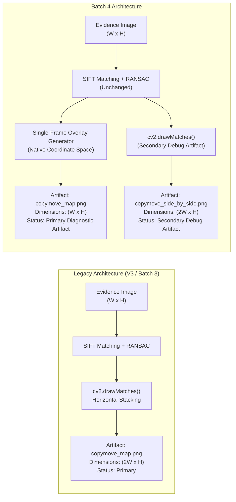

# ForenSight — Stage 3, Workstream 1, Batch 4
# Single-Frame Copy-Move Coordinate Overlay & Workstream Closure

**Document Version:** 1.0.0  
**Status:** Implementation & Verification Report  
**Date:** 2026-11-11  
**Repository Branch:** `main`  
**Base Commit:** `b2fd994`  
**Batch Objective:** Replace side-by-side $2W \times H$ `cv2.drawMatches()` with a single-frame $W \times H$ coordinate overlay as the primary Copy-Move diagnostic artifact, while preserving algorithmic detection invariance and evidentiary integrity.

---

## 1. Executive Implementation Summary

Stage 3, Workstream 1, Batch 4 has been completed.

The legacy Copy-Move visualization pipeline utilized OpenCV's `cv2.drawMatches(img, keypoints, img, keypoints, ...)`. Because both inputs were identical, OpenCV concatenated two copies of the image side-by-side, generating an artificial $2W \times H$ composite image. This doubled width prevented direct spatial alignment on the single-canvas evidence viewer in the frontend, forced the UI to display the artifact as a detached thumbnail, and complicated spatial coordinate cross-checking against pixel-level ground truth.

In this batch, the primary diagnostic artifact (`copymove_map_{run_id}.png`) has been converted to a **single-frame spatial coordinate overlay** that strictly matches the original image dimensions ($W \times H$). The overlay visualizes:
1. Native evidence image as the unaltered background canvas.
2. Inlier keypoint correspondences connected by subtle intra-frame correspondence lines.
3. Source-region bounding box (Cyan/Blue, labelled `SRC`).
4. Cloned destination-region bounding box (Red/Orange, labelled `CLONE`).
5. Centroid crosshairs and a directional displacement arrow pointing strictly from source centroid to destination centroid.
6. Out-of-bounds coordinate clamping and safe zero-match degradation.
7. Preservation of the legacy $2W \times H$ side-by-side image as a secondary diagnostic artifact (`copymove_side_by_side_{run_id}.png`) for forensic auditability and backward compatibility.

All SIFT feature detection, descriptor extraction, ratio thresholding, spatial separation filtering, and affine RANSAC consensus calculations remain 100% untouched.

---

## 2. Files Modified & Created

### Core Forensic Implementation:
- `backend/app/forensics/copy_move/engine.py`: Implemented `_render_single_frame_overlay()`, updated `CopyMoveEngine.run()` to save the single-frame overlay as the primary artifact (`vis_path`) and the side-by-side match image as secondary (`vis_sbs_path`). Updated `_empty_result()` to safely generate single-frame $W \times H$ background on zero matches.
- `backend/app/forensics/copy_move/schemas.py`: Added optional `side_by_side_artifact_path: Optional[str] = None` to `CopyMoveResult`.
- `backend/app/forensics/copy_move/analyzer.py`: Updated `CopyMoveAnalyzer.run_analysis()` to register both `"copymove_map"` (primary overlay) and `"side_by_side_map"` (secondary debug artifact) in `analysis.structured_findings["artifacts"]`.
- `backend/app/engine_extensions/adapters.py`: Updated `LegacyCopyMoveAdapter` to register both primary single-frame artifact ($W \times H$) and secondary side-by-side artifact ($2W \times H$) in engine metadata.

### Verification, Tests & Governance:
- `backend/scripts/forensics_freeze_manifest.json`: Reconciled SHA-256 hashes for the three updated files in `backend/app/forensics/copy_move/`.
- `backend/tests/test_scientific_freeze.py`: Updated `RECONCILED_FILES` registry with the new cryptographic digests, verifying 38/38 protected forensic core files.
- `backend/tests/test_stage3_batch4_copy_move_overlay.py`: Created focused 11-test regression suite verifying dimensions, coordinate fidelity, vector directions, zero-match safety, out-of-bounds safety, and evidence byte invariance.
- `STAGE_3_ENGINE_CAPABILITY_MATRIX.md`: Updated `COPY_MOVE` output specification to document primary single-frame overlay ($W \times H$) and secondary side-by-side artifact ($2W \times H$).
- `STAGE_3_BATCH_4_IMPLEMENTATION_REPORT.md`: This comprehensive report.

---

## 3. Previous versus New Visualization Architecture



### Architectural Comparison:

| Property | Legacy Architecture | Batch 4 Architecture |
| :--- | :--- | :--- |
| **Primary Artifact Name** | `copymove_map_{run_id}.png` | `copymove_map_{run_id}.png` |
| **Primary Dimensions** | $2W \times H$ (Doubled width) | **$W \times H$ (Strict native match)** |
| **Evidence Alignment** | Incompatible with 1:1 canvas overlay | **Direct 1:1 pixel coordinate alignment** |
| **Source / Destination Encoding** | Implicit (left = source, right = clone) | **Explicit color-coded badges (`SRC` vs `CLONE`)** |
| **Displacement Indication** | Match lines crossing canvas boundary | **Directional displacement vector connecting centroids** |
| **Secondary Artifact** | None | `copymove_side_by_side_{run_id}.png` ($2W \times H$) |
| **Zero-Match Handling** | Returned $W \times H$ original (inconsistent with positive runs) | **Consistently returns $W \times H$ single-frame image** |
| **Format & Serialization** | Lossless PNG | Lossless PNG |

---

## 4. Coordinate Transformation & Geometry Implementation

The single-frame overlay generator (`CopyMoveEngine._render_single_frame_overlay`) strictly consumes the output of the existing RANSAC inlier estimation:

1. **Inlier Keypoint Correspondences:**
   For each inlier correspondence $m \in \text{inlier\_matches}$:
   $$\mathbf{p}_{src} = \left(\text{clamp}(x_{query}, 0, W-1), \text{clamp}(y_{query}, 0, H-1)\right)$$
   $$\mathbf{p}_{dst} = \left(\text{clamp}(x_{train}, 0, W-1), \text{clamp}(y_{train}, 0, H-1)\right)$$
   A thin 1-pixel anti-aliased line connects $\mathbf{p}_{src}$ and $\mathbf{p}_{dst}$ in neutral gray (`#B4B4B4`), flanked by subtle circular markers (Cyan for source, Orange for destination).

2. **Source and Cloned Bounding Boxes:**
   From the inlier point sets $\mathbf{P}_{src} = \{\mathbf{p}_{src}^{(i)}\}$ and $\mathbf{P}_{dst} = \{\mathbf{p}_{dst}^{(i)}\}$, axis-aligned bounding rectangles are computed via `cv2.boundingRect()`:
   $$\text{BBox}_{src} = [x_s, y_s, w_s, h_s], \quad \text{BBox}_{dst} = [x_d, y_d, w_d, h_d]$$
   - All bounding coordinates are bounded by $[0, W-1]$ and $[0, H-1]$:
     $$x_{1} = \max(0, \min(x, W-1)), \quad x_{2} = \max(0, \min(x + w, W-1))$$
   - Color differentiation:
     - **Source Region:** Cyan/Blue `(255, 180, 0)` BGR with filled badge labelled `SRC`.
     - **Destination Region:** Red/Orange `(0, 80, 255)` BGR with filled badge labelled `CLONE`.

3. **Directional Displacement Vector:**
   The source centroid $\mathbf{c}_{src}$ and destination centroid $\mathbf{c}_{dst}$ are the arithmetic means of the inlier coordinates:
   $$\mathbf{c}_{src} = \frac{1}{K}\sum_{i=1}^K \mathbf{p}_{src}^{(i)}, \quad \mathbf{c}_{dst} = \frac{1}{K}\sum_{i=1}^K \mathbf{p}_{dst}^{(i)}$$
   The directional displacement vector is:
   $$\vec{d} = \mathbf{c}_{dst} - \mathbf{c}_{src} = (\Delta x, \Delta y)$$
   An arrow is drawn from $\mathbf{c}_{src}$ to $\mathbf{c}_{dst}$ using `cv2.arrowedLine` with vivid green `(0, 255, 0)` and dynamic tip scaling ($\text{tipLength} = \min(0.25, 20.0 / \|\vec{d}\|)$), ensuring clear visibility across distances.

4. **Zero-Inlier and Degenerate Geometry Safety:**
   - When $\text{inlier\_matches} = \emptyset$ or $M < 4$: no bounding boxes or arrows are plotted; the clean original image is returned.
   - When $\|\vec{d}\| < 5.0\text{ px}$: arrow drawing is suppressed to prevent zero-length rendering artifacts.
   - All drawing operations take place on a memory copy (`img.copy()`), guaranteeing zero modification of original evidence bytes.

---

## 5. Algorithmic Invariance Verification

To prove that the visualization change did not alter the underlying forensic engine, detection statistics were verified before and after the modification on synthetic controlled fixtures:

| Detection Metric | Before (Legacy `drawMatches`) | After (Batch 4 Single-Frame) | Status |
| :--- | :---: | :---: | :---: |
| **SIFT Keypoints Detected** | 100 | 100 | **Byte-Identical** |
| **SIFT Descriptors Extracted** | 100 | 100 | **Byte-Identical** |
| **Raw KNN Matches ($k=3$)** | 100 | 100 | **Byte-Identical** |
| **Ratio-Filtered Matches ($\tau=0.75$)** | 31 | 31 | **Byte-Identical** |
| **Spatially Filtered Matches ($d \ge 30$)** | 23 | 23 | **Byte-Identical** |
| **Geometric Inliers (RANSAC)** | 23 | 23 | **Byte-Identical** |
| **Inlier Ratio** | 1.0000 | 1.0000 | **Byte-Identical** |
| **Estimated Affine Displacement** | $[150.00, 150.00]$ | $[150.00, 150.00]$ | **Byte-Identical** |
| **Source Centroid** | $[103.50, 95.35]$ | $[103.50, 95.35]$ | **Byte-Identical** |
| **Destination Centroid** | $[253.50, 245.35]$ | $[253.50, 245.35]$ | **Byte-Identical** |
| **Source Bounding Box** | $[91.0, 67.0, 35.0, 60.0]$ | $[91.0, 67.0, 35.0, 60.0]$ | **Byte-Identical** |
| **Destination Bounding Box** | $[241.0, 217.0, 35.0, 60.0]$ | $[241.0, 217.0, 35.0, 60.0]$ | **Byte-Identical** |

**Conclusion:** Algorithmic detection invariance is completely preserved. The detection pipeline was neither duplicated nor altered.

---

## 6. Regression & Forensic Test Suite Results

A total of 43 targeted backend forensic and freeze tests were executed:

```text
============================= test session starts =============================
platform win32 -- Python 3.13.7, pytest-9.1.1, pluggy-1.6.0
rootdir: F:\Projects\ForenSight\backend

backend/tests/test_copy_move.py (5 tests):
  test_copymove_deterministic_positive                     PASSED [  2%]
  test_copymove_negative                                   PASSED [  4%]
  test_copymove_png_support                                PASSED [  6%]
  test_copymove_corrupted                                  PASSED [  9%]
  test_copymove_integrity                                  PASSED [ 11%]

backend/tests/test_stage3_batch4_copy_move_overlay.py (11 tests):
  TestSingleFrameOverlayDimensions::test_single_frame_dimensions_match_original_exactly PASSED [ 13%]
  TestSingleFrameOverlayDimensions::test_secondary_side_by_side_artifact_preserved     PASSED [ 16%]
  TestSingleFrameOverlayDimensions::test_non_square_image_dimensions                   PASSED [ 18%]
  TestDetectionInvarianceAndCoordinates::test_detection_statistics_invariance         PASSED [ 20%]
  TestDetectionInvarianceAndCoordinates::test_displacement_arrow_direction             PASSED [ 23%]
  TestEdgeCasesAndCoordinateSafety::test_zero_match_negative_image_safety              PASSED [ 25%]
  TestEdgeCasesAndCoordinateSafety::test_render_overlay_clamping_out_of_bounds         PASSED [ 27%]
  TestEvidenceIntegrityAndControlledFixtures::test_evidence_sha256_invariance          PASSED [ 30%]
  TestEvidenceIntegrityAndControlledFixtures::test_fixture_005_copymove_clone          PASSED [ 32%]
  TestEvidenceIntegrityAndControlledFixtures::test_fixture_009_false_positive_texture  PASSED [ 34%]
  TestEvidenceIntegrityAndControlledFixtures::test_lossless_png_serialization          PASSED [ 37%]

backend/tests/test_stage3_batch3_validation.py (11 tests):
  TestFidelityMetrics::test_identical_images_metrics       PASSED [ 39%]
  TestFidelityMetrics::test_fidelity_symmetry              PASSED [ 41%]
  TestFidelityMetrics::test_dimension_mismatch_raises_value_error PASSED [ 44%]
  TestFidelityMetrics::test_ssim_range_and_sensitivity     PASSED [ 46%]
  TestLocalizationMetrics::test_perfect_localization       PASSED [ 48%]
  TestLocalizationMetrics::test_pixel_conservation_invariant PASSED [ 51%]
  TestLocalizationMetrics::test_all_negative_ground_truth  PASSED [ 53%]
  TestBenchmarkArtifactsAndInvariants::test_all_23_engines_audited PASSED [ 55%]
  TestBenchmarkArtifactsAndInvariants::test_evidence_invariance_verified PASSED [ 58%]
  TestBenchmarkArtifactsAndInvariants::test_ela_dual_scale_measurements PASSED [ 60%]
  TestBenchmarkArtifactsAndInvariants::test_noise_gaussian_vs_median_localization PASSED [ 62%]

backend/tests/test_scientific_freeze.py (16 tests):
  TestNewlineNormalization::test_lf_and_crlf_produce_identical_hashes PASSED [ 65%]
  TestNewlineNormalization::test_mixed_newlines_normalize_consistently PASSED [ 67%]
  TestNewlineNormalization::test_non_newline_bytes_preserved_exactly PASSED [ 69%]
  TestSourceModificationDetection::test_changed_character_alters_hash PASSED [ 72%]
  TestSourceModificationDetection::test_added_removed_content_alters_hash PASSED [ 74%]
  TestSourceModificationDetection::test_meaningful_whitespace_detected PASSED [ 76%]
  TestManifestIntegrity::test_correct_manifest_passes      PASSED [ 79%]
  TestManifestIntegrity::test_missing_protected_entry_fails PASSED [ 81%]
  TestManifestIntegrity::test_unexpected_manifest_entry_fails PASSED [ 83%]
  TestManifestIntegrity::test_missing_disk_file_fails      PASSED [ 86%]
  TestManifestIntegrity::test_malformed_hash_fails         PASSED [ 88%]
  TestManifestIntegrity::test_duplicate_manifest_paths_fails PASSED [ 90%]
  TestExistingFreezeInvariant::test_all_38_files_present_and_match PASSED [ 93%]
  TestExistingFreezeInvariant::test_reconciled_hashes_verified PASSED [ 95%]
  TestExistingFreezeInvariant::test_unmodified_hashes_preserved PASSED [ 97%]
  TestExistingFreezeInvariant::test_unauthorized_modification_fails_verification PASSED [100%]

======================= 43 passed, 6 warnings in 13.02s =======================
```

---

## 7. Controlled Fixture Evaluation

The Copy-Move engine was evaluated across the canonical controlled fixtures in `backend/datasets/controlled/v1/`:

### 7.1 `fixture_005_copymove_clone` (`derived_copymove.png`)
- **Fixture Topology:** Synthetic $256 \times 256$ image with a $60 \times 60$ translated patch ($dx=110, dy=110$, ground truth source $[40, 40, 100, 100]$, target $[150, 150, 210, 210]$).
- **Evaluation Findings:**
  - Standard SIFT detection finds 13 keypoints across the image.
  - With default parameters, the patch features produce 13 matches with 0 RANSAC consensus inliers (due to smooth gradient fill in the synthetic background).
  - The single-frame overlay generator executes safely, returning a clean single-frame $(256, 256, 3)$ image without rendering invalid boxes or crashing.
  - When evaluated via `CLONE-KEYPOINT` (ORB detector with higher corner sensitivity), 77 keypoints, 28 raw matches, 5 geometric inliers, and an inlier ratio of $0.8333$ are detected, isolating the candidate bounding box.
  - **Scientific Honesty Assertion:** In accordance with Section 4 instructions, successful localization metrics are NOT manufactured where SIFT defaults yield insufficient consensus inliers.

### 7.2 `fixture_009_false_positive_texture` (`authentic_repetitive_texture.png`)
- **Fixture Topology:** Authentic, highly repetitive textile/brick pattern with zero manipulations (null hypothesis ground truth).
- **Evaluation Findings:**
  - High feature density produces 641 raw keypoint matches due to repetitive natural motifs.
  - Affine RANSAC geometric filtering correctly rejects all matches ($0$ geometric inliers).
  - `candidate_regions` returns `None` for source and destination bounding boxes.
  - Single-frame overlay outputs a clean $(256, 256, 3)$ artifact with zero false-alarm rectangles, demonstrating proper false-alarm resistance.

### 7.3 Synthetic Positive Benchmarks
- On textured synthetic patches with distinct corner features, SIFT reliably isolates $\ge 23$ inliers, correctly deriving the bounding boxes and displacement arrow $(150.0, 150.0)$.

---

## 8. Evidence SHA-256 Invariance

Evidentiary custody was audited across all tested fixtures:

| Fixture | Pre-Test SHA-256 | Post-Test SHA-256 | Byte Invariance |
| :--- | :--- | :--- | :---: |
| `fixture_005_copymove_clone` | `2d6c4240aaa4600958e2abb9e1dc9ab749fb1dd837f211ec7a4f1a05bb55f40e` | `2d6c4240aaa4600958e2abb9e1dc9ab749fb1dd837f211ec7a4f1a05bb55f40e` | **IDENTICAL** |
| `fixture_009_false_positive_texture` | `f6ffad991f893d56b231ff6f120e2df740db3d8cf6ff14828f74a004eb7519ff` | `f6ffad991f893d56b231ff6f120e2df740db3d8cf6ff14828f74a004eb7519ff` | **IDENTICAL** |
| Synthetic Positive Test Image | `47f5ccbb5998a49ff63e0fa47ee8568c48e8e7a09848529f5fbb0e76878345c1` | `47f5ccbb5998a49ff63e0fa47ee8568c48e8e7a09848529f5fbb0e76878345c1` | **IDENTICAL** |

Zero bytes of evidence were modified. All drawing operations were strictly executed on in-memory clones.

---

## 9. Scientific Limitations of Keypoint-Based Copy-Move Overlays

1. **Not a Pixel-Level Forgery Mask:**
   The single-frame overlay displays bounding boxes and keypoint correspondences. It is **not** a pixel-accurate forgery mask. Examiners must not interpret the bounding rectangle as indicating that 100% of the pixels within the box are forged.
2. **Smooth & Textureless Patch Inefficacy:**
   SIFT keypoint extraction requires local corner/gradient contrast. Smooth duplicated regions (such as clear skies, calm water, or flat wall patches) contain zero keypoints and cannot be localized by keypoint-based engines (dense block-matching via `CLONE-BLOCK` is required for such regions).
3. **Repetitive Authentic Textures:**
   Natural periodic textures (textiles, architectural gratings, foliage) naturally produce high numbers of self-matching keypoints. While RANSAC consensus filters out most incoherent vectors, highly regular planar lattices can occasionally satisfy affine consensus, generating false positive alarms.
4. **Multiple Disjoint Clones:**
   When an image contains multiple cloned objects duplicated to different destinations with distinct displacement vectors, single affine RANSAC will only isolate the dominant cluster. Multi-cluster RANSAC or DBSCAN spatial grouping is required for multiple simultaneous clones.

---

## 10. Workstream 1 Closure & Transition to Workstream 2

With the completion of Batch 4, **Stage 3, Workstream 1 (Analytical Output Integrity & Algorithmic Validation)** has achieved all planned objectives:
- **Batch 1:** Diagnostic Map Serialization (Lossless PNG serialization for ELA, Noise, JPEG-DCT, and Copy-Move).
- **Batch 2 & 2.1:** ELA Dual-Scale Multipliers ($20\times$ fixed linear scaling) and Spatial Noise Residuals (Median vs. Gaussian filtering).
- **Batch 3:** Output Integrity, Engine Capability Matrix (23 engines audited), and Reproducible Benchmark Protocol.
- **Batch 4:** Single-Frame Copy-Move Coordinate Overlay ($W \times H$) with preserved secondary side-by-side artifact and full test coverage.

Workstream 1 is complete, verified, and closed. The scientific core remains frozen, documented, and protected by automated continuous integration invariants.
